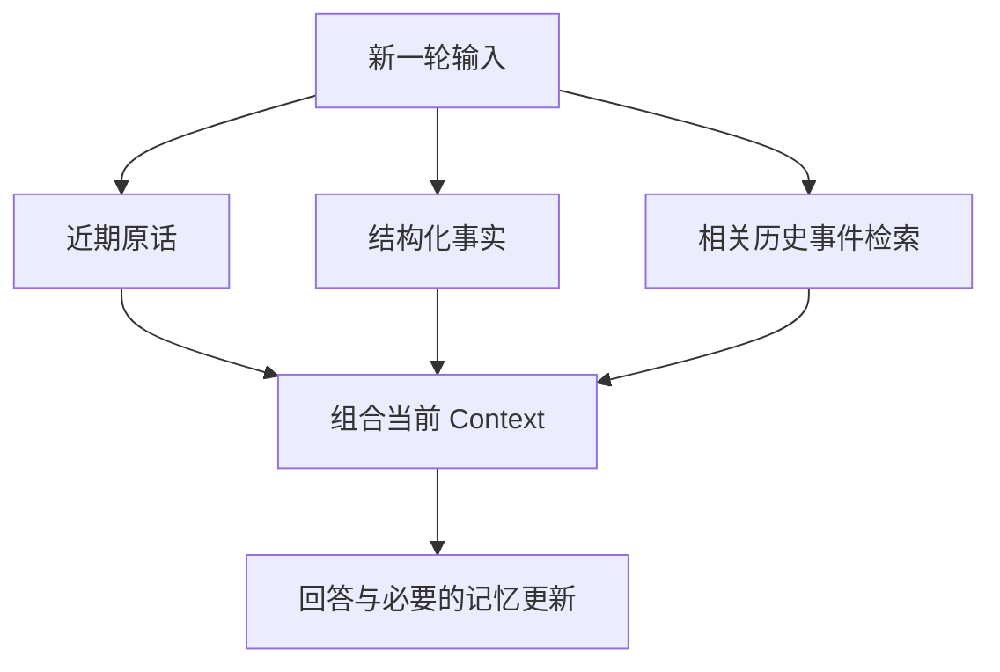

# 79. 百轮对话记忆：分层保存与按需召回

> **场景引入**：用户刚说“不再喝咖啡”，后台记忆更新尚未完成。下一轮若仍读到旧偏好，系统就会推荐咖啡。

> 对应[原始材料](../origanl/79-Agent长记忆设计：如何记住百轮对话？.md)。

---

## 🎯 一句话定位

“记住百轮”不是把百轮原文每次都发给模型，而是把近期对话、稳定事实和可检索的历史事件分层管理。记忆系统还要支持更正、遗忘与用户删除。原稿称结构化画像能“保证事实不丢”过于绝对：提取本身也可能出错。

---

## 💎 核心要点概览

| 层 | 存什么 |
| --- | --- |
| 近期原话 | 省略、指代与最新明确要求 |
| 结构化事实 | 经确认的当前偏好与身份字段 |
| 历史事件 | 需按任务检索的旧经历 |
| 权威业务数据 | 订单、支付等实时状态 |

---

## 🚀 核心总结

> **百轮记忆要分层选取、处理冲突，而不是每轮都喂百轮原文。**

---

## 一、三层怎么分

**近期原话**保留省略和指代所需的几轮对话。**结构化事实**保存用户确认过的姓名、偏好或项目配置，带来源、时间和有效期。**情景记录**保存可供以后回看的事件片段，用关键词和语义检索按需召回。不是所有闲聊都值得写入，更不能未经用户同意长期保存敏感信息。

## 二、最难的是冲突与更新

用户曾说“害怕狗”，后来表示“现在不怕了”。系统不能把两条都无差别送给模型，应标记旧事实失效或保留时间线。用户说“别再记这个”，删除应影响主存储、检索索引及后续提示。异步提取能减少前台等待，但必须处理写入延迟：用户刚纠正的事实在下一轮立即生效，不能等后台任务。

## 三、怎样验证记忆质量

用百轮脚本包含早期事实、后期纠正、同名实体、删除请求和无关噪声，测正确召回、错误记忆引用、最新指令覆盖率及延迟。长期情景检索只能提供候选证据，模型回答前仍需核对原文。

**面试口述：**“近期对话保留原话，稳定事实结构化存储，情景事件按需检索。每条记忆带来源与时间，处理冲突、删除和异步写入延迟；用长对话回归集评估。”

**自检：**用户刚说“我不再喝咖啡”，后台更新尚未完成，下一轮该用哪条偏好？

---

## 四、落地 Checklist

- [ ] 最新明确指令优先于旧偏好摘要。
- [ ] 记忆附时间、来源、有效性与权限。
- [ ] 异步更新延迟有可观察和兜底机制。
- [ ] 用户更正与删除能传播到检索副本。

## 五、总结（一句话带走）

> **会更新、会遗忘、会核对来源，比单纯“记得多”更重要。**
