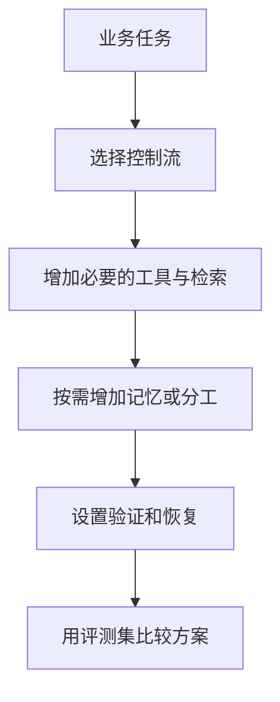

# 80. 八种 Agent 模式：用四个问题完成选型

> **场景引入**：只查询一个订单状态，却设计自主循环和五个子 Agent。系统复杂度上去了，结果反而可能更慢、更难排错。

> 对应[原始材料](../origanl/80-一次性搞懂AI%20Agent八大主流架构.md)。这篇与第 53 篇主题相近，这里侧重可操作的选型顺序。

---

## 🎯 一句话定位

**先看流程固定性、任务依赖、事实来源和验证责任，再决定是否增加 Agent 模式。**

---

## 💎 核心要点概览

| 四问 | 选型影响 |
| --- | --- |
| 流程固定吗 | 决定工作流还是动态循环 |
| 依赖很长吗 | 决定是否规划与重规划 |
| 事实从哪来 | 决定工具、检索和记忆 |
| 谁负责复核 | 决定规则、测试与人工节点 |

---

## 🚀 核心总结

> **架构应该从简单基线逐步增加，每项复杂性都要有评测收益。**

---

## 一、四个选型问题

1. **流程固定吗？** 固定则先用普通工作流；未知步骤需要边观察边行动时才引入 ReAct/自主循环。
2. **任务有长依赖吗？** 长任务可先计划再执行，并在证据变化时重规划。
3. **事实从哪里来？** 当前业务事实走工具，外部资料走检索，跨会话偏好走受控记忆。
4. **谁负责复核？** 反思可发现明显遗漏，但真正的正确性应由规则、测试、原始证据或人工确认。

原稿列出的 ReAct、Plan and Execute、Multi Agent 和 Autonomous Loop 主要描述控制流或角色分工；Tool Augmented、Memory Augmented、RAG 描述能力来源；Reflective 描述复核方式。这些维度能组合，不是八选一。例如一个单 Agent 售后系统可以在有界循环中查订单工具与规则 RAG，再用业务规则验证答案，无须再加多个 Agent。

## 二、比较时别只看演示

同一组真实任务下测正确率、遗漏率、工具重复调用、尾部延迟、token 成本和人工接管率。计划执行不保证“支持回滚”：外部动作是否可撤销取决于业务系统。RAG 不保证“自动溯源”：引用需要保存来源且经核对。多 Agent 不保证更高效率：协调和冲突可能抵消并行收益。

**面试口述：**“我把八种标签拆成控制流、事实来源和验证方式，再根据任务复杂度组合最小方案。先用固定流程和单 Agent 建基线，只有评测证明需要时才加规划、多 Agent 或记忆。”

**自检：**任务只是查询一个订单状态，使用自主循环加五个子 Agent 会带来什么问题？

---

## 三、选型 Checklist

- [ ] 已建立直接调用或固定流程的简单基线。
- [ ] 每个新增 Agent 或能力有明确缺口与收益。
- [ ] 复杂方案的延迟、成本和故障率已测量。
- [ ] 高风险动作由确定性规则和权限控制。

## 四、总结（一句话带走）

> **能用简单链路解决，就不为“八种架构”增加不必要的复杂度。**
