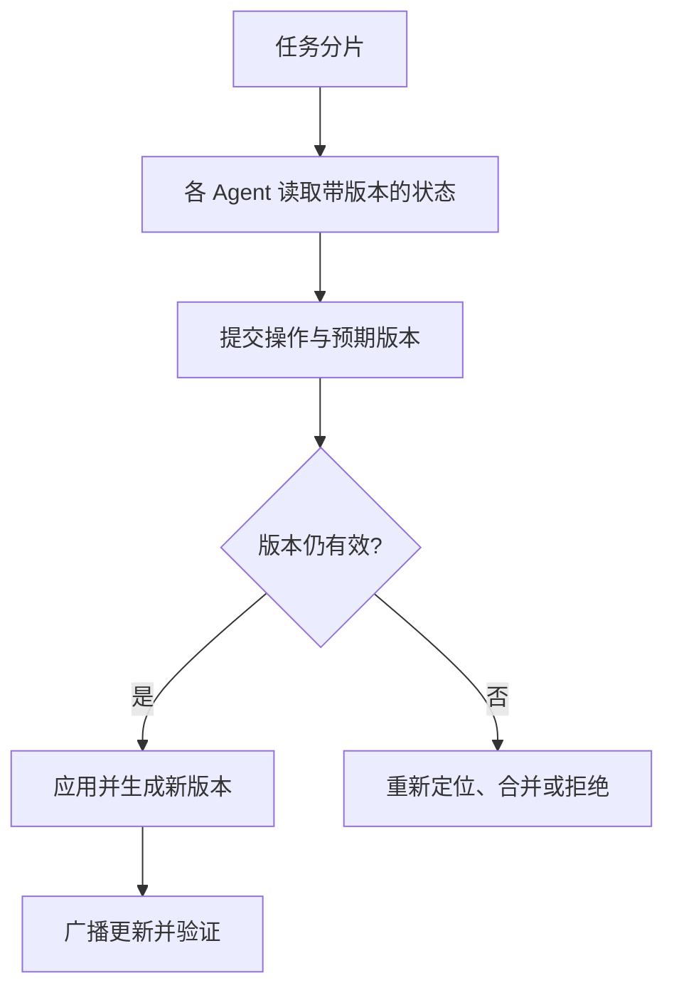

# 81. 多 Agent 协作：版本、分片与合并

> **场景引入**：A 基于报告 v5 插入数据，B 基于同一旧版删除第三段。即使写操作排队，B 口中的“第三段”也可能已经变了。

> 对应[原始材料](../origanl/81-多Agent协同如何防冲突？.md)。原稿把锁、消息队列与 CRDT 描述为普遍优劣，实际取决于数据类型和一致性要求。

---

## 🎯 一句话定位

**多 Agent 写入冲突不只发生在同一时刻，还发生在基于过期版本作决定时。**

---

## 💎 核心要点概览

| 手段 | 解决的问题 |
| --- | --- |
| 任务分片 | 减少重叠修改 |
| 版本校验 | 阻止旧结果覆盖新状态 |
| 合并策略 | 处理不相交与语义冲突 |
| 锁/队列 | 在必要处控制写入时序 |

---

## 🚀 核心总结

> **提交时说明“基于哪个版本、改了哪里”，再由系统裁决是否接受。**

---

## 一、用报告编辑看冲突

两个 Agent 同时编辑一份报告：A 在第二段插入市场数据，B 基于旧版本删除第三段。即使把两次写操作排队执行，B 的“第三段”也可能已不是原目标。冲突不只是写入同时发生，还包括**基于旧状态做出决定**。

## 二、三种手段怎样选

**任务分片**减少碰撞：每个 Agent 负责独立章节或业务对象。**乐观并发控制**在写入时比较版本，过期操作不直接覆盖。**串行队列或锁**可用于关键共享资源，虽牺牲部分并行性，却可能是正确的取舍。原稿称锁“效率完全归零”不成立：只串行冲突资源，其余任务仍可并发。

CRDT 适用于某些可合并的数据类型和协作编辑，但它不自动解决语义冲突。例如两个 Agent 分别把预算改成 100 万和 80 万，数学上的合并并不能决定业务上哪个正确。对于支付、审批、删除等动作，仍要业务状态机与人工裁决。

**面试口述：**“我先按资源分片，写入携带基准版本；过期结果重读并合并或拒绝。锁与队列只用于必要的冲突点；CRDT 适合可合并状态，不能代替业务语义裁决。”

**自检：**两个 Agent 对同一订单分别给出‘退款’和‘拒绝退款’，自动合并字段能决定正确结果吗？

---

## 三、落地 Checklist

- [ ] 写入带基准版本与变更范围。
- [ ] 版本检查和提交原子完成。
- [ ] 同区域或业务结论冲突不自动覆盖。
- [ ] 合并后的结果重新验证。

## 四、总结（一句话带走）

> **版本解决“旧写入”，业务规则解决“该不该合并”。**
