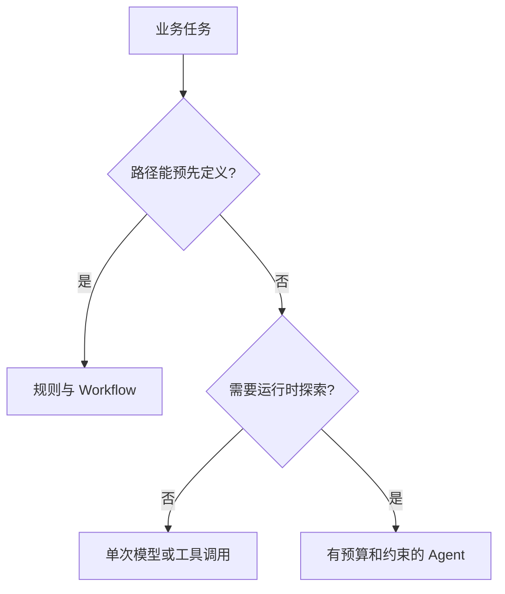

# 82. 什么时候不该用自主 Agent

> **场景引入**：每天导入同格式报表，固定脚本能稳定完成。如果改成自主 Agent 决定步骤，可能只增加延迟、成本和错误。

> 对应[原始材料](../origanl/82-别滥用Agent！这四种场景坚决不能用.md)。标题中的“坚决不能”应理解为选型警示，不是绝对禁令。

---

## 🎯 一句话定位

如果每个步骤、分支和失败处理都能提前写清，普通程序或 Workflow 往往更简单、更可测。Agent 适合路径会随新信息变化的开放任务。判断标准不是“能否接上大模型”，而是动态决策能否带来超过成本与风险的收益。

---

## 💎 核心要点概览

| 任务特点 | 更直接的方案 |
| --- | --- |
| 固定步骤和分支 | 普通程序或 Workflow |
| 只需一次理解 | 单次模型调用 |
| 高风险且无可靠验收 | 先建确定性规则与人工流程 |
| 运行时必须探索 | 有边界的 Agent Loop |

---

## 🚀 核心总结

> **是否使用 Agent 看动态决策的增益是否超过它的成本与风险。**

---

## 一、四类应谨慎使用的场景

1. **固定转换**：文档格式转换、字段抽取等，单次模型或确定性处理即可；循环可能增加不必要步骤。
2. **严格时延与成本**：每增加一轮模型或工具调用都会增加尾延迟，需先测基线。
3. **强规则、高风险写入**：支付、审批、医疗设备控制等由确定性服务执行；模型最多辅助解释或准备材料。
4. **缺乏反馈和验证**：没有可检查的目标、工具结果或终止条件，Agent 只会开放式猜测，难以证明完成。

这不意味着以上业务完全不能使用模型。可以把模型放在分类、提取或建议节点，把流程与最终授权留给代码和人。先做固定方案，再用同一评测集检查动态 Agent 是否改善难例，并记录额外延迟和错误率。

**面试口述：**“路径确定、成本敏感或不可容错的任务先用 Workflow；模型用于理解和表达，关键业务规则由代码验证。只有运行时需要根据反馈探索时，我才引入有界 Agent Loop。”

**自检：**每天同格式导入报表，能用固定脚本完成，为什么还要让 Agent 自主决定步骤？

---

## 二、选型 Checklist

- [ ] 已确认路径和分支是否能预先写清。
- [ ] 简单脚本、工作流和单次调用有基线结果。
- [ ] Agent 增加的质量收益与延迟、费用已比较。
- [ ] 高风险执行仍由确定性校验控制。

## 三、总结（一句话带走）

> **能稳定预先写出的流程，不需要为“智能”引入自主循环。**
