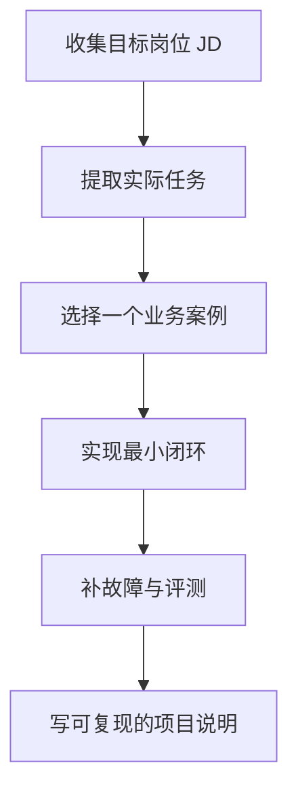

# 83. Agent 开发求职：用岗位要求倒推练习

> **场景引入**：简历写“做过 RAG”，面试官问扫描 PDF 的错召回如何定位，若拿不出具体 Trace，名词就无法证明能力。

> 对应[原始材料](../origanl/83-大模型Agent开发求职与学习路线.md)。原稿主要介绍付费课程，其模块数、资料规模与求职效果不是本篇推荐依据。

---

## 🎯 一句话定位

**按目标岗位的真实任务倒推一个能运行、能排错、能解释取舍的项目。**

---

## 💎 核心要点概览

| JD 关键词 | 应准备的工程证据 |
| --- | --- |
| RAG | 文档解析、召回、引用和失败案例 |
| 工具调用 | 参数、权限、超时与幂等 |
| Agent 架构 | 状态、终止、恢复与评测 |
| 项目经验 | 本人贡献、迭代记录和复现方法 |

---

## 🚀 核心总结

> **岗位名词要翻译成可回答的工程问题和可复现的项目证据。**

---

## 一、把 JD 变成问题清单

看到“RAG”，不要只会解释定义，要能回答：扫描 PDF 怎么解析？召回不准如何定位？引用如何核对？看到“工具调用”，要能解释参数校验、超时、权限、幂等。看到“Agent 架构”，要能说明状态、终止、恢复和评估。用这些工程问题找自己的短板。

## 二、一条可执行路线

**基础**：理解 token、上下文、模型 API 与结构化输出。**检索**：处理真实文档，完成来源引用与错误分析。**工具**：接一个只读 API 和一个需要审批的写操作，验证权限与幂等。**运行时**：加入任务状态、超时、重试、人工接管。**评估**：固定测试问题，记录成功率、错误分类、延迟和成本。

每学一块都留一份证据：代码、架构图、失败用例和改进前后指标。简历写“实现了订单查询与售后规则答复，处理规则过期与工具超时”，比堆“精通 RAG/MCP/LangGraph”更可核查。岗位要求随公司而变，应以具体 JD 和项目经历为准。

**面试口述：**“我按岗位问题练习：资料解析与检索、工具失败和权限、Agent 状态与评估。项目从真实任务出发，每个技术选择都有失败样例与数据支持。”

**自检：**简历写“做过 RAG”，面试官追问错召回案例，你能拿出哪条 trace？

---

## 三、实践 Checklist

- [ ] 选定目标岗位并列出常见任务和失败场景。
- [ ] 用一个业务案例展示完整执行链。
- [ ] 保留 Trace、测试样例和改进前后证据。
- [ ] 准确说明个人工作，不借课程成果冒充线上经历。

## 四、总结（一句话带走）

> **求职准备的核心是可核查能力，而非记住更多术语。**
