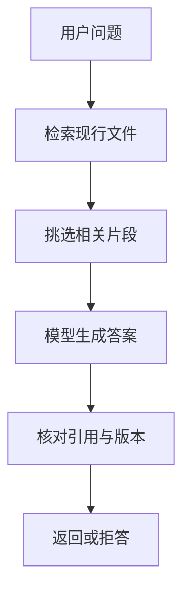

# 84. 用图解理解 Agent：从一条请求链开始

> **场景引入**：用户问公司差旅报销上限。要答对，系统需找现行制度、定位条款、交给模型表达，再核对数字与引用。

> 对应[原始材料](../origanl/84-动画图解大模型Agent，零基础轻松学.md)。原稿是课程推广，几乎没有技术细节；本文把“先看流程再看实现”的学习方法做成独立入门文档。

---

## 🎯 一句话定位

**入门先看一条业务请求怎样经过数据、模型与验证，再把技术名词放回对应环节。**

---

## 💎 核心要点概览

| 环节 | 要追问的“为什么” |
| --- | --- |
| 检索 | 为什么选这份制度与版本 |
| 生成 | 模型拿到什么证据 |
| 验证 | 数字、范围和引用是否一致 |
| 失败 | 找不到依据时怎样回答 |

---

## 🚀 核心总结

> **图帮助看清位置，真实样例帮助证明理解。**

---

## 一、先看懂一条请求链

用户问“公司差旅报销上限是多少？”应用先识别问题，检索现行制度，选择相关条款，把条款与问题一起交给模型，最后核对回答是否引用了正确章节。图看懂后，才能知道每个技术名词处于哪一步。

## 二、用“为什么”逐段学习

为什么检索前要检查权限？因为用户不能通过问答看到无权访问的制度。为什么分块不能只按字数？因为可能切断“上限 1000 元，但海外例外”的条件。为什么要核对引用？因为模型可能引用了相关文件，却写错具体数字。为什么需要拒答？因为找不到有效文件时，流畅语言并不是事实依据。

## 三、从图到代码

先用 5～10 份自己有权使用的文档做原型，保存每一步输入输出；再加入过期文件、相似标题、表格和无答案问题。能解释错误发生在检索、分块还是生成，就比记住“RAG 流程图”更进一步。无需购买特定课程才能完成这套练习。

**面试口述：**“我用一条业务请求串起输入、检索、生成、验证，再逐段测试失败。图解帮助定位模块，真实样例帮助验证理解。”

**自检：**模型答错上限时，你能区分是检索拿错文件还是生成改错数字吗？

---

## 四、实践 Checklist

- [ ] 每个节点都有输入、输出和失败路径。
- [ ] 答案能回到现行制度原文。
- [ ] 解析错误与生成错误可区分。
- [ ] 能用一条真实问题讲清完整链路。

## 五、总结（一句话带走）

> **先画出请求链，再逐段实现和排错。**
