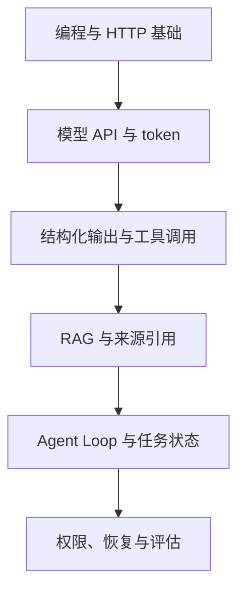

# 85. 零基础 Agent 学习：按依赖顺序搭建能力

> **场景引入**：刚学编程就同时接多 Agent、MCP、向量库和复杂框架，容易每处都能跑 Demo，却说不清工具结果如何回传或报错如何处理。

> 对应[原始材料](../origanl/85-零基础学AI%20Agent开发，动画图解轻松入门.md)。原稿是课程销售文案；本文保留学习路线主题，不转述“学完即可拿 offer”等营销承诺。

---

## 🎯 一句话定位

**按编程基础、模型调用、工具与检索、任务状态、评测的依赖顺序学习，每一步做出可验证结果。**

---

## 💎 核心要点概览

| 阶段 | 最小练习 |
| --- | --- |
| 编程与 HTTP | 调用接口并处理错误 |
| 模型 API | 稳定解析结构化输出 |
| 工具与检索 | 获取实时事实与可引用资料 |
| Agent 运行时 | 保存状态、控制循环与权限 |
| 评测 | 用失败样例验证改动 |

---

## 🚀 核心总结

> **学习速度来自把前一层真正用起来，而非一开始铺满技术栈。**

---

## 一、学习顺序

先掌握普通程序的输入、输出、函数与错误处理，再学模型 API、上下文和工具调用。接着处理知识检索、任务状态、权限与评估。不要一开始就把多 Agent、MCP、向量库和复杂框架全部堆入同一项目。

## 二、每一步的验收题

- **模型 API**：能解释输入、输出、token 用量和超时。
- **工具调用**：模型提出调用后，应用执行什么？返回错误时怎样回传？
- **RAG**：从原文到答案，能定位资料、召回或生成造成的错误。
- **Agent Loop**：能设置停止条件，阻止重复工具调用。
- **生产约束**：能处理未授权写入、重复请求和人工审批。

每学完一项就加到一个小项目中，例如电商售后助手。先答规则，再查实时订单，最后模拟高风险退款审批。用 Git 记录每次迭代为什么改、改了什么和怎样验证。动画和图适合建立直觉，但必须通过代码与失败用例检查自己是否真的理解。

**面试口述：**“我按依赖从模型调用、工具与检索学到运行时和评估，每一步都在同一业务案例里验证，而不是只记名词。”

**自检：**只会画工具调用图，却说不清工具结果如何回传给模型，还缺哪一步练习？

---

## 三、实践 Checklist

- [ ] 每个阶段有能运行的最小成果。
- [ ] 能解释模型请求、工具返回与错误处理。
- [ ] 同一小项目逐步扩展，而非不停更换 Demo。
- [ ] 课程宣传与实际能力验证分开判断。

## 四、总结（一句话带走）

> **基础顺序搭对，复杂 Agent 架构才有可理解的支点。**
