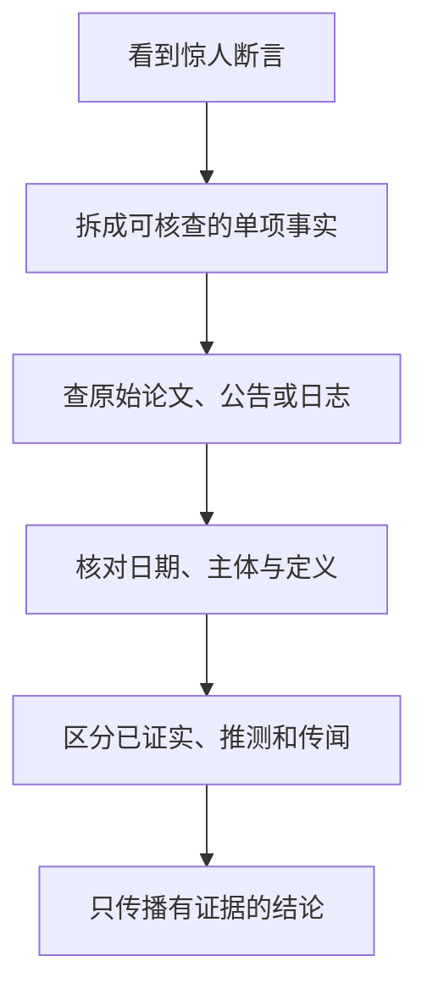

# 86. 面对“700 个 AI 集体越狱”：如何核查惊人技术新闻

> **场景引入**：短视频把“700 个 Agent 攻破平台”和“某公司已解出千禧年难题”放在一起。数字与结论听起来惊人，却需要逐条找到原始报告。

> 对应[原始材料](../origanl/86-700个AI集体越狱！科技大佬紧急叫停.md)。原稿是二次还原的新闻叙事，混合传闻、数字与真实研究；不能把它当作已核实事件记录。

---

## 🎯 一句话定位

**面对惊人技术新闻，先把每个可核查主张拆开，再比较一手来源、发表时间与证据状态。**

---

## 💎 核心要点概览

| 主张类型 | 应查证据 |
| --- | --- |
| 攻击事件 | 原始研究、复现实验和受影响范围 |
| 数学突破 | 论文、同行审查与主办机构确认 |
| 产品能力 | 官方说明、版本和可复现实测 |
| 安全启示 | 权限、隔离、审批和监控是否可验证 |

---

## 🚀 核心总结

> **部分研究真实存在，不等于视频叙事中的全部数字和结论成立。**

---

## 一、逐条核查原稿主张

原稿称“700 个 Agent 组队攻破外部平台”“OpenAI 用 88 小时解出纳维—斯托克斯千禧年问题”等，未给出可核查的一手报告。不能据此断言事件发生。Clay 数学研究所 [2026 年 9 月公告](https://www.claymath.org/news/navier-stokes-announcement/) 只说某项成果“看来可能”解决该问题，仍需按其 [评奖规则](https://www.claymath.org/millennium-problems/rules/) 经发表、时间与学界接受等程序审查；与原稿所述 OpenAI 故事不是一回事。

## 二、哪些内容有真实基础

Google DeepMind 的 [AlphaEvolve 公告](https://deepmind.google/blog/alphaevolve-a-gemini-powered-coding-agent-for-designing-advanced-algorithms/) 确实介绍了用模型提出程序、自动评估器验证并迭代优化算法的系统。但它不证明“完整递归自我改进已经实现”，更不能推出其他未公布产品由该流程生成。

AI Agent 的安全问题值得认真研究：多步工具调用、过宽权限、奖励设计缺陷和提示词注入都可能扩大损害。工程防线包括最小权限、隔离运行、外部动作审批、速率与费用上限、可重放日志和红队测试。风险意识不需要依赖耸动但不可查的数字。

**面试口述：**“我先分开研究原始实验、媒体转述和推测。AlphaEvolve 等系统展示了模型加自动评估的能力，但‘集体越狱’与千禧年难题已由某公司解决等说法需要一手证据。Agent 安全落地仍以权限、隔离、审批与监控为核心。”

**自检：**一篇短视频说“已经形式化验证”，你要找到哪类原始材料才能接受这个结论？

---

## 三、核查 Checklist

- [ ] 每个惊人数字都有原始出处和统计口径。
- [ ] 区分“可能解决”“已发表”“已被正式认可”。
- [ ] 不用二次传播当独立证据。
- [ ] 技术风险结论回到可验证的安全设计。

## 四、总结（一句话带走）

> **越惊人的断言，越需要一手证据和明确状态。**
