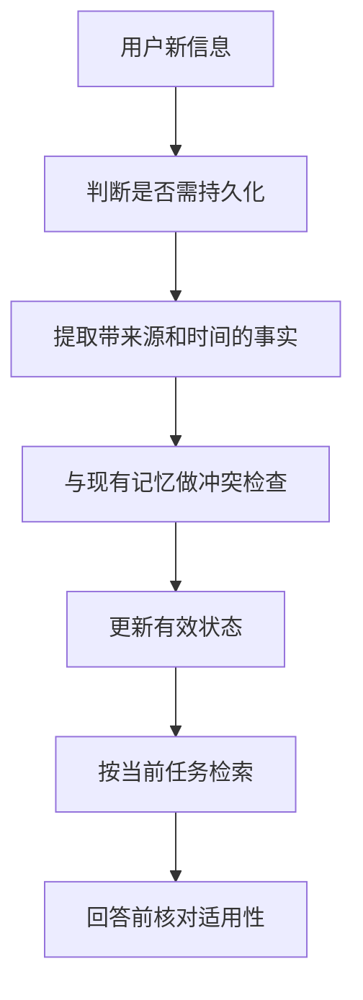

# 87. 面试题：设计可用三年的 Agent 记忆

> **场景引入**：用户三年前喜欢甜咖啡，现在已戒糖。如果旧偏好还留在检索索引中，系统可能在主表更新后仍给出旧推荐。

> 对应[原始材料](../origanl/87-AI智能体面试：如何设计长期记忆系统.md)。

---

## 🎯 一句话定位

三年记忆的关键不是存储容量，而是**什么时候写、怎样检索、发生冲突怎么办、用户怎样更正和删除**。用户三年前喜欢甜咖啡，最近戒糖；如果两条都无时间和来源地进入上下文，模型可能答错。

---

## 💎 核心要点概览

| 问题 | 设计重点 |
| --- | --- |
| 何时写 | 有用、获授权且有来源 |
| 怎样读 | 结合任务、时间和有效性 |
| 冲突怎么办 | 区分更正、暂时状态与历史事实 |
| 如何删除 | 主存储、索引和摘要都要处理 |

---

## 🚀 核心总结

> **三年记忆的难点是更新与治理，不是存储容量。**

---

## 一、三层设计

**当前会话**保留近期原话；**工作状态**记任务进度和工具结果；**长期记忆**保存经授权的跨会话事实与事件。用户明确说“记住”时可立即写入，但健康、财务等敏感信息仍应遵守产品的同意和保留规则。后台整理可做去重与摘要，却不能延迟当前纠正生效。

每个记忆条目带用户 ID、内容、类型、来源、观察时间、有效时间、置信度和删除标记。读取时结合关键词、语义、时效和重要性；不能用简单“越新越重要”覆盖高风险事实。压缩对话时保留原始金额、日期、否定词和用户明确的约束。

## 二、验收而非背诵

用跨天、多轮和冲突样例测试：旧偏好是否正确失效；同名用户是否串记忆；用户要求删除后是否还能从向量索引召回；找不到记忆时是否会编造。记录错记率、漏记率、删除生效时间和隐私事件。

**面试口述：**“我把会话、任务状态和长期事实分开；长期条目有时间、来源与有效性。写入前判断价值和授权，检索时处理冲突，支持更正与删除，并用跨天回归集评估。”

**自检：**用户要求忘记花生过敏信息，只删数据库主表、不清向量索引是否足够？

---

## 三、记忆 Checklist

- [ ] 长期事实有来源、时间和有效状态。
- [ ] 新旧偏好冲突不会由相似度自动裁决。
- [ ] 用户更正和删除覆盖索引、副本与摘要。
- [ ] 跨天、跨版本测试验证记忆行为。

## 四、总结（一句话带走）

> **能纠错和遗忘的记忆，才可能长期可靠。**
