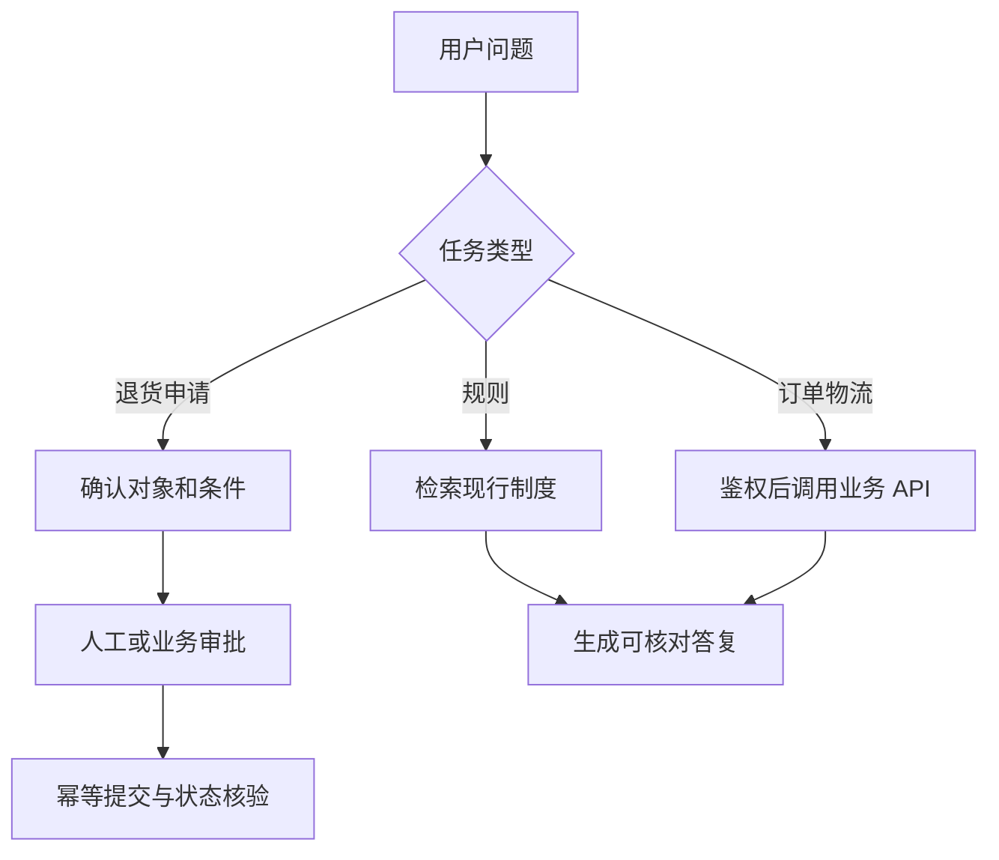

# 88. 电商客服 Agent：从问答到受控业务操作

> **场景引入**：用户问物流位置，需要实时订单接口；用户要发起退货，又涉及权限与状态变更。把两类请求都交给模型“直接回答”会出错。

> 对应[原始材料](../origanl/88-转行Agent？从零实战电商客服.md)。原稿是课程推广；本文把其业务路线整理为独立项目方案。

---

## 🎯 一句话定位

让客服系统处理三种不同任务：回答售后规则、查询实时订单/物流、协助发起退货申请。三种任务的数据来源与风险不同，不能都交给模型自由生成。先做只读能力，再逐步加入需要确认和审批的写操作。

---

## 💎 核心要点概览

| 任务 | 数据与控制 |
| --- | --- |
| 售后规则问答 | 检索现行制度并引用 |
| 订单物流查询 | 鉴权后查实时业务 API |
| 退货申请 | 确认对象、规则、权限和审批 |
| 失败处理 | 超时查状态、幂等与 Trace |

---

## 🚀 核心总结

> **客服 Agent 应从只读事实问答逐步升级到受控写操作。**

---

## 一、四次迭代

**版本 1**：只回答非个性化规则，要求带来源和无法回答时拒答。**版本 2**：接只读订单工具，用户身份与订单归属由后端校验。**版本 3**：增加退货申请草稿，展示条件和影响，用户确认后才提交；写接口用幂等键。**版本 4**：记录 trace、失败分类与回归集，加入超时、人工接管与审计。

每次迭代都留“为何修改、改动点、怎样测试”的记录。例如模型编造物流单号时，解决办法是把实时物流作为唯一可信来源，并在接口失败时明确告诉用户“暂时查不到”，而不是继续生成轨迹。

**面试口述：**“我按规则问答、实时查询、受控提交逐步扩展。静态规则走可溯源检索，订单走鉴权 API，退款类动作需要确认、幂等与状态核验。每一版用固定样例和 trace 验证。”

**自检：**用户问‘快递到哪了’，物流接口超时，Agent 能否推测一个单号？

---

## 二、项目 Checklist

- [ ] 规则与订单分别使用正确来源。
- [ ] 接口超时不让模型编造物流或退款状态。
- [ ] 写操作前有用户确认与执行层鉴权。
- [ ] 每版有成功与失败的回归样例。

## 三、总结（一句话带走）

> **能回答问题与能改变订单，是不同风险等级的能力。**
