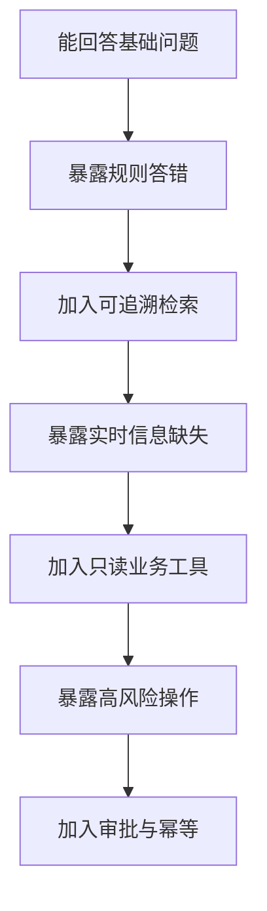

# 90. 用持续迭代避免 Agent 学习停在 Demo

> **场景引入**：新提示词让客服回答更顺，却意外跳过退款确认。若每个版本没有固定回归样例，就无法发现“局部变好、整体变差”。

> 对应[原始材料](../origanl/90-学Agent总踩坑？带你做电商实战.md)。原稿主要推销课程；这里提炼“同一业务案例、每次解决一个问题”的学习方法。

---

## 🎯 一句话定位

不断换教程会让时间花在环境配置和目录适应上，难以看清设计演进。选一个电商售后场景，固定用户、订单、商品和规则数据，每次只引入一个新问题，才能比较前后版本的质量与复杂度。

---

## 💎 核心要点概览

| 每次迭代记录 | 目的 |
| --- | --- |
| 原问题 | 证明改动有业务原因 |
| 方案与取舍 | 解释为什么引入该技术 |
| 验证结果 | 证明缺口被修复 |
| 回归结果 | 发现原有能力是否退化 |

---

## 🚀 核心总结

> **围绕一个业务场景持续改进，才能看清技术选择的收益与副作用。**

---

## 一、每次提交都写四句话

**问题**：某类真实输入失败了什么？**选择**：为什么用这项技术，而不是修改提示词或规则？**改动**：哪些模块和数据契约变化？**验证**：新增用例通过了吗，旧用例是否回归？例如“物流信息编造”不能只通过加一句“不要编造”解决，应让回复依赖物流 API 的真实返回。

环境问题也要可复现：固定依赖版本、提供测试数据和启动脚本，记录错误信息与解决过程。能运行并不代表能上线，最终还需权限、日志、监控、成本预算和人工接管。课程的版本数量、涨价与学员反馈不影响这套方法是否有效。

**面试口述：**“我围绕同一个电商任务逐步迭代，每次从失败样例出发，解释技术选择并跑回归测试。重点是能证明新版本改善了什么，同时没破坏原能力。”

**自检：**新提示让规则问答更顺畅，却使退款确认被跳过，该用什么证据发现？

---

## 二、迭代 Checklist

- [ ] 每版只解决明确的业务缺口。
- [ ] 关键写操作与安全约束纳入回归。
- [ ] 指标和案例能复现，不写无口径提升。
- [ ] 能说明改动带来的维护成本。

## 三、总结（一句话带走）

> **学习成果应体现在可追踪的迭代，而不是 Demo 数量。**
