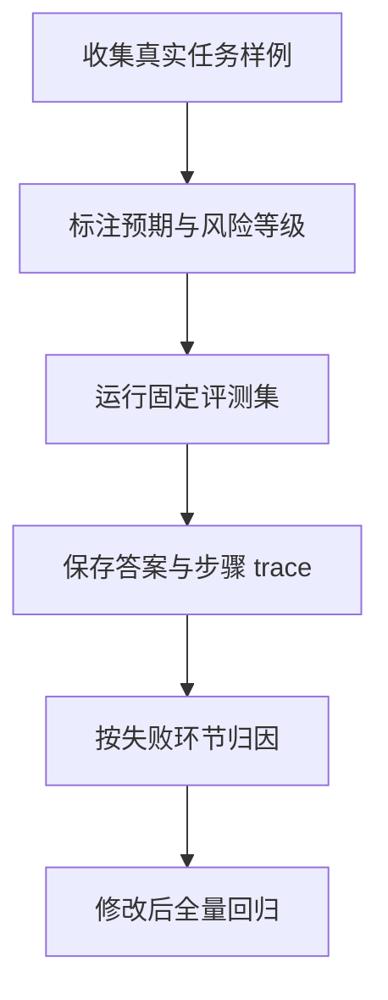

# 91. 如何证明 Agent 项目质量

> **场景引入**：客服 Agent 回答准确率提高，却多发了几笔错误退款。只看答题分数会把实际业务风险藏起来。

> 对应[原始材料](../origanl/91-如何证明你的AI%20Agent项目做得好？.md)。

---

## 🎯 一句话定位

“演示能跑通”不是质量证据。需要一套固定任务集、明确的成功标准、运行 trace 和版本对比，分别评估**答案、工具动作、风险控制和成本**。Agent 质量不能只靠一个“准确率”概括。

---

## 💎 核心要点概览

| 维度 | 看什么 |
| --- | --- |
| 答案 | 正确性、引用和应拒答时的拒答 |
| 动作 | 工具选择、参数与最终业务状态 |
| 风险 | 越权、重复执行、错误退款 |
| 效率 | 延迟、人工接管与成本 |

---

## 🚀 核心总结

> **项目质量要看结果、过程和副作用，不能靠演示或单一准确率证明。**

---

## 一、电商客服的指标

**规则问答**：答案是否正确、是否引用现行条款、该拒答时是否拒答。**订单查询**：是否选对工具、参数中的订单 ID 是否正确、是否越权读到其他用户数据。**退款申请**：确认与审批是否完整、重复请求是否只执行一次、失败是否如实反馈。**体验**：首字和完成延迟、人工接管率、每任务费用。

## 二、怎样做评测集

从脱敏工单抽样，覆盖正常、模糊、冲突、无答案、工具超时和恶意输入；每个样例记录可接受答案、必须引用的证据及禁止动作。对开放式答案可人工抽检或用辅助评分，但金额、订单状态、权限等关键事实要由规则和业务系统验证。评测数据与开发样例分开，避免只对熟悉题目调优。

Trace 记录每轮模型请求、检索片段、工具参数和结果、耗时与版本。失败时先确定是文档、检索、参数、业务接口还是生成问题，再修改相应环节。每次改提示或模型都跑旧场景，防止局部优化造成回归。

**面试口述：**“我用标注任务集评估答案与业务动作，trace 分解每一步，按失败根因改进，再做版本回归。还看越权、重复执行、延迟和成本，不用单一成功率掩盖风险。”

**自检：**回答准确率提高，但错误退款次数增加，能说项目整体变好了吗？

---

## 三、评测 Checklist

- [ ] 固定任务集包含正常、边界和高风险样例。
- [ ] 保存答案与步骤 Trace，能定位失败环节。
- [ ] 关键风险指标设独立门槛。
- [ ] 新版本与旧版本在同一条件下比较。

## 四、总结（一句话带走）

> **好项目要能证明“答对、做对、没越界、成本可接受”。**
