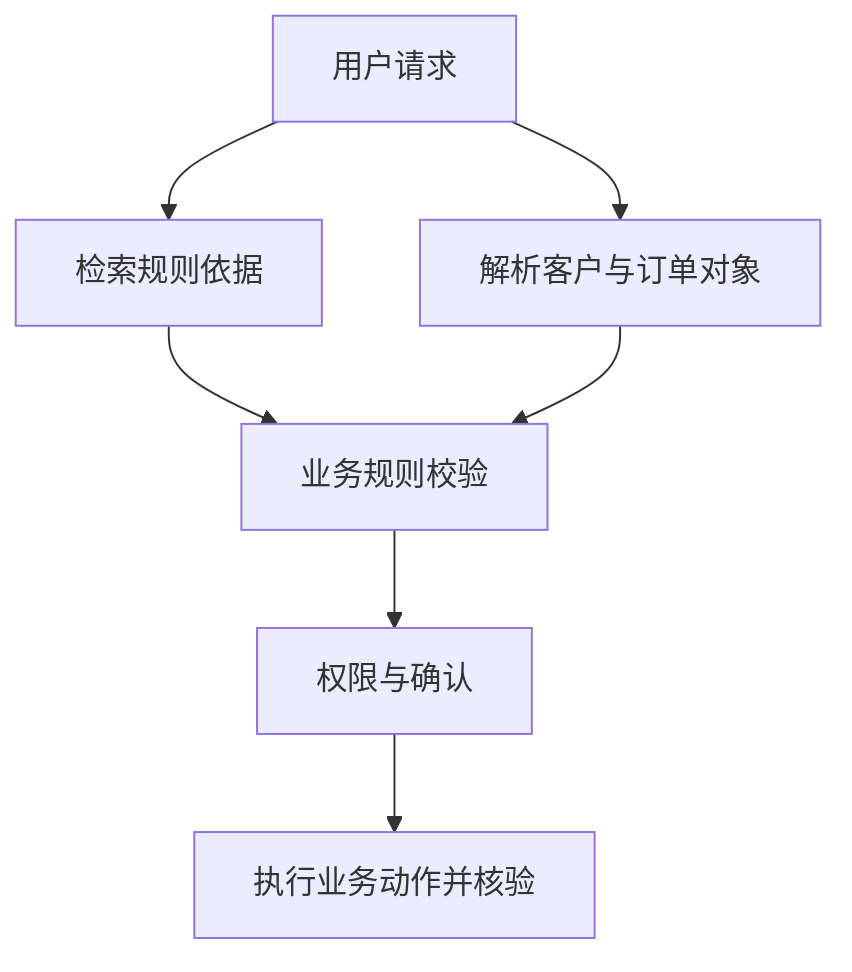

# 92. 知识库接入业务：资料、对象与动作三层

> **场景引入**：用户说“取消下周的订单”。退款手册解释了规则，却不能告诉系统哪张订单、当前状态和执行权限。

> 对应[原始材料](../origanl/92-知识库落地业务，只用RAG还不够.md)。原稿把 RAG、LLM Wiki、Ontology 排成固定的“升级阶梯”，实际是不同职责，可按需求组合。参考 [Palantir Ontology 文档](https://www.palantir.com/docs/foundry/ontology/overview/)。

---

## 🎯 一句话定位

**资料回答规则，业务对象提供当前事实，受控动作才完成业务；三层不能互相替代。**

---

## 💎 核心要点概览

| 层 | 需要回答的问题 |
| --- | --- |
| 资料 | 当前有效规则是什么 |
| 对象 | 用户说的是哪张订单，状态如何 |
| 动作 | 谁能取消，如何审批和核验 |

---

## 🚀 核心总结

> **知识库能支持判断，不能直接代替实时系统与业务执行。**

---

## 一、为什么问答正确还不够

用户说“取消下周的订单”。退款制度文档可以解释规则，却不能确定“下周的订单”是哪张、是否已发货、用户是否有权取消。要完成业务，系统需要三层信息：**规则依据、实时业务对象、受控动作**。

## 二、三层各做什么

RAG 根据问题查原始资料并保留引用。Wiki 是整理过的知识页面，可帮助发现概念、流程和文档链接；“LLM Wiki”并非统一标准，具体能力取决于产品。Ontology 或领域模型定义客户、订单、支付等对象及关系，帮助系统把自然语言映射到真实业务实体；它也不是执行权限的替代品。

在取消订单例子里，规则资料说明取消条件；订单 API 给出现行状态；领域模型说明订单与支付、物流的关联；确定性业务服务完成状态变更。即使三个层面都齐全，仍要用业务接口做最终鉴权和幂等。

**面试口述：**“RAG 回答规则是什么，业务对象层回答当前是哪笔订单及其关系，受控服务决定能否执行。Wiki 可整理资料，Ontology 可建模对象，但最终动作仍需实时状态与权限校验。”

**自检：**仅凭退款手册，Agent 能判断某笔具体订单现在是否可退吗？

---

## 三、落地 Checklist

- [ ] 当前规则有版本和原文引用。
- [ ] 用户订单被定位到唯一业务 ID。
- [ ] 实时状态从业务系统读取。
- [ ] 执行前后都有权限与结果校验。

## 四、总结（一句话带走）

> **从“知道怎么办”到“真的办成”，还需要对象、状态与授权。**
