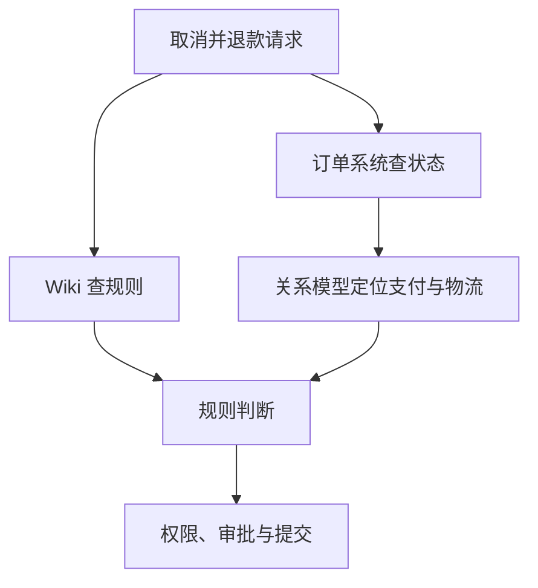

# 93. Wiki 为什么不能独自支撑业务执行

> **场景引入**：员工手册说“发货前可以取消”，但订单刚刚发货。系统必须查实时订单台账，不能只凭 Wiki 的规则文字执行。

> 对应[原始材料](../origanl/93-Wiki做Agent大脑已经不够用了.md)。原稿关于行业趋势与厂商路线的断言不作为通用事实；这里聚焦资料与实时状态的差别。

---

## 🎯 一句话定位

**Wiki 组织规则与背景，业务系统提供当前对象状态；实际动作还要经过授权。**

---

## 💎 核心要点概览

| 信息 | 典型来源 |
| --- | --- |
| 通用规则与解释 | Wiki 或制度库 |
| 对象关系 | 业务语义层或明确接口 |
| 当前订单、支付、物流 | 实时业务系统 |
| 允许执行的动作 | 权限与审批服务 |

---

## 🚀 核心总结

> **把手册当台账，会误判具体业务；把台账当规则，也会误用条件。**

---

## 一、用员工手册与订单台账理解

Wiki 像员工手册，能告诉你“退款一般按哪些规则办理”；业务系统像订单台账，告诉你“这位客户的这张订单目前是什么状态”。只拿手册，无法知道某笔订单是否发货、优惠券是否退回、退款金额如何算。

## 二、Ontology 解决哪一部分

领域本体或对象模型把“客户—订单—支付—物流”及可用操作明确表示，减少模型凭词语相似度猜关系。业务对象应有稳定 ID、字段定义、关系、版本和权限。它可帮助查询与编排，但**不能自动保证金额正确或执行合法**：这些仍由支付、库存、退款服务的规则与事务决定。

## 三、什么时候不必建复杂本体

如果只是几十份规章的只读问答，文档检索与 Wiki 导航可能足够。若需要跨系统定位对象、查询实时状态和执行动作，再逐步建立领域模型。先选一个业务流程做试点，验证对象映射准确率、状态新鲜度、权限和失败恢复，避免一次性画出庞大却无人维护的关系图。

**面试口述：**“Wiki 提供规则知识，业务执行还要实时对象状态、对象关系和确定性动作服务。Ontology 帮助统一对象语义，但不替代权限和业务规则。我会按场景复杂度逐步引入。”

**自检：**Wiki 显示‘可在发货前取消’，但订单刚发货，系统应依据哪一层信息决策？

---

## 四、落地 Checklist

- [ ] 规则与实时状态分别查询。
- [ ] 复杂对象关系有明确建模与来源。
- [ ] 小场景先验证简单接口是否足够。
- [ ] 权限与结果核验不交给 Wiki 文本。

## 五、总结（一句话带走）

> **知识页面能说明规则，业务系统才能证明此刻发生了什么。**
