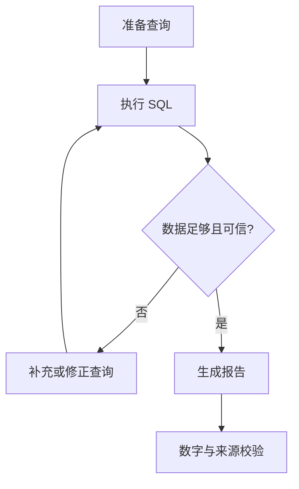

# 94. LangChain 与 LangGraph：面试时讲清状态流转

> **场景引入**：分析销售下降原因时，SQL 查数不足要补查，报告数字不对要回退。只说“一个是链、一个是图”，解释不了流程怎样恢复。

> 对应[原始材料](../origanl/94-LangChain与Graph面试解析.md)。具体产品能力以 [LangGraph 官方概览](https://docs.langchain.com/oss/python/langgraph/overview) 为准。

---

## 🎯 一句话定位

**框架选型要从状态、分支、循环、人工介入和恢复需求说起，而非背名称差异。**

---

## 💎 核心要点概览

| 设计点 | 面试要讲清 |
| --- | --- |
| 状态 | 当前有哪些数据和版本 |
| 节点 | 每步读取、修改和返回什么 |
| 边 | 成功、缺数据或错误时去哪里 |
| 终止 | 重试几次、何时人工接管 |

---

## 🚀 核心总结

> **画出真实状态流转，比简单对比“链”和“图”更能说明工程理解。**

---

## 一、从一个销售分析任务说起

“分析销售下降原因”可能先查 SQL，发现数据不足再补查，生成报告前还要验证数字。面试时仅说“LangChain 是链、LangGraph 是图”不够，应画出状态是什么、每个节点修改什么、失败时走哪里。

## 二、核心概念

LangChain 提供模型、工具、检索和 Agent 组件的抽象与集成。LangGraph 侧重显式状态和控制流：Node 负责步骤，Edge 决定下一步，State 保存跨节点数据；持久化和中断机制可支持长任务恢复。二者可组合，不能说 LangChain 只能线性执行或 LangGraph 不需要工具封装。

## 三、回答深挖追问

**状态如何流转？** 定义 `query`、`rows`、`attempts`、`evidence` 等字段；节点只更新其负责字段。**SQL 失败怎么办？** 按错误类型有限重试，记录失败原因；权限或语义不清时转人。**如何避免无限循环？** 设置步数、时间和成本预算，并在无数据进展时停止。**如何恢复？** checkpoint 保存图状态；外部写操作仍需幂等或对账。

**面试口述：**“我用状态字段描述业务进度，Node 做单一职责，条件 Edge 根据验证结果分支。框架帮管理编排与恢复，但 SQL 权限、重试上限和最终数字校验由应用设计。”

**自检：**SQL 一直报语法错，图中回到生成 SQL 节点多少次后应停止？

---

## 四、落地 Checklist

- [ ] 状态字段和节点输入输出清楚。
- [ ] 错误分支与重试上限明确。
- [ ] SQL 权限和结果校验由应用控制。
- [ ] 恢复后核对数据是否仍有效。

## 五、总结（一句话带走）

> **图框架管理流程，业务正确性仍靠状态与校验设计。**
