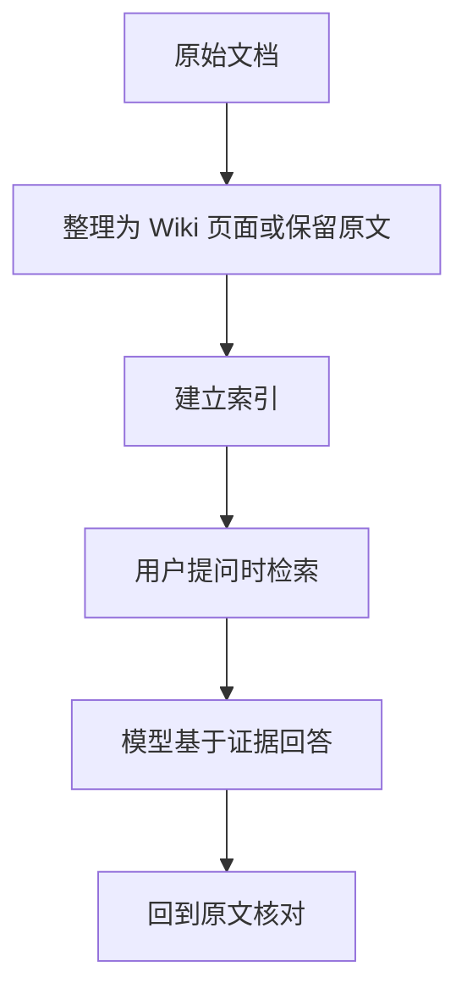

# 95. RAG 与“LLM Wiki”：先澄清术语

> **场景引入**：一个 Wiki 页面被检索系统索引后，它既是 Wiki 内容，也可以是 RAG 的资料来源。两个词描述的不是同一维度。

> 对应[原始材料](../origanl/95-RAG与LLM%20Wiki的核心区别.md)。原稿把“LLM Wiki”定义成某类固定轻量组件，其他原稿又定义成自动整理的知识页面；该词没有统一技术含义，选型前必须问清具体产品和实现。

---

## 🎯 一句话定位

**RAG 描述“回答时检索资料”的过程，Wiki 描述“怎样组织资料”的内容形态。**

---

## 💎 核心要点概览

| 维度 | RAG | Wiki |
| --- | --- | --- |
| 核心用途 | 按问题找证据并辅助生成 | 按主题组织和维护页面 |
| 数据来源 | Wiki、PDF、数据库等 | 人工或自动整理的资料 |
| 共通要求 | 版本、权限、溯源与质量验证 | 版本、权限、溯源与质量验证 |

---

## 🚀 核心总结

> **先问清“LLM Wiki”在具体产品中的含义，再比较能力；两者可叠加。**

---

## 一、共同点与差异

RAG 是一种处理方式：在生成答案前检索外部资料，给模型提供证据。Wiki 是组织知识的形式：页面、标题、链接、版本和编辑流程。一个 Wiki 可以作为 RAG 的数据源；一个 RAG 系统也可以检索 PDF、数据库记录或网页，不要求先做 Wiki。

如果某产品把“上传文件即可问答”命名为 LLM Wiki，它可能内部使用 RAG；切块、重排、过滤和提示是否可调要看该产品功能，不能凭名称推断“只能做小规模”“一定没有权限控制”。反过来，自建 RAG 也不天然更准确，需要投入解析、评估和运营成本。

## 二、选型时问五个问题

资料能否按版本更新？用户权限能否进入检索过滤？回答能否定位到原文？检索失败能否调试？总体成本和维护责任谁承担？用同一批真实问题比较现成 Wiki 问答与自建 RAG 的命中率、引用正确率和延迟。

**面试口述：**“RAG 是检索增强生成方法，Wiki 是知识组织与产品形态；两者可叠加。‘LLM Wiki’必须先明确具体定义，再比较可配置性、权限、溯源与评测能力。”

**自检：**一个 Wiki 页面被 RAG 系统索引后，它属于 Wiki 还是 RAG？

---

## 三、选型 Checklist

- [ ] 已确认所说 Wiki 的具体产品与实现。
- [ ] 明确用户要主题浏览还是事实问答。
- [ ] 页面与答案可追溯到原文和版本。
- [ ] 权限与更新机制已经验证。

## 四、总结（一句话带走）

> **Wiki 管资料组织，RAG 管检索使用；不要把两个维度当成替代品。**
