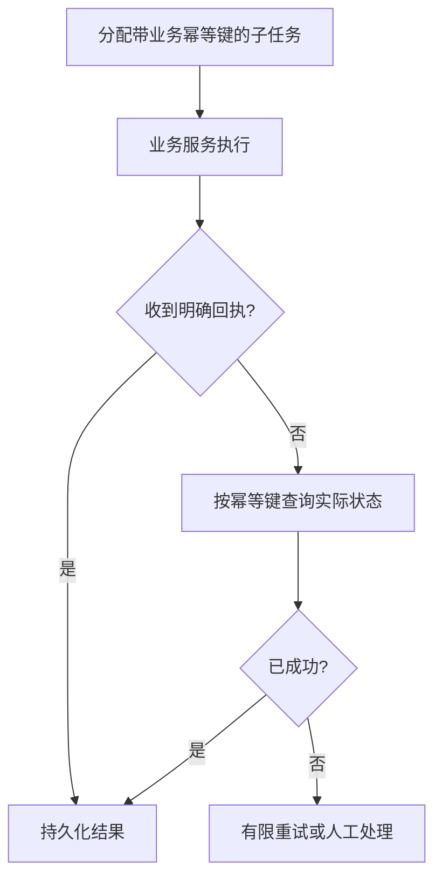

# 96. 多 Agent 一致性：业务状态比消息顺序重要

> **场景引入**：Agent A 提交扣费成功，回执却在网络中丢失；调度器把任务交给 B 重试。只凭“没收到成功”就再扣一次，会造成重复支付。

> 对应[原始材料](../origanl/96-如何保证多Agent协作一致性.md)。与第 57 篇主题相近，这里重点分析“任务已成功但回执丢失”的恢复。

---

## 🎯 一句话定位

**业务一致性以权威系统的实际状态为准，不能由消息是否送达或 Agent 的表述决定。**

---

## 💎 核心要点概览

| 问题 | 控制方式 |
| --- | --- |
| 回执丢失 | 按业务操作 ID 查询状态 |
| 重复派发 | 同一动作复用幂等键 |
| 旧结果写入 | 共享状态版本校验 |
| 部分成功 | 补偿或人工接管 |

---

## 🚀 核心总结

> **超时先查状态，再决定是否重试；同一业务意图不能被执行两次。**

---

## 一、故障场景

Agent A 提交扣费，支付服务成功；返回结果在网络中丢失。调度器看到超时后把任务交给 Agent B 重试。如果只依靠“收到成功消息才算成功”，就可能重复扣费。真正的一致性要看支付服务的最终状态，而非 Agent 的自然语言报告。

## 二、设计要点

全局任务和子任务有稳定 ID 与状态机；写操作由业务系统保存幂等键和唯一约束。调度记录投递、领取、执行和回执，重启后可以扫描未决任务。共享对象更新带版本条件，防止旧观察覆盖新状态。异构 Agent 统一返回 schema：状态、证据、业务流水号、错误类别；不能只汇总“做完了”。

原稿建议“语义指纹”去重，但自然语言相似不能替代业务幂等键：两笔描述相同的合法订单可能应各执行一次。补偿要针对具体动作设计，且可能失败，需要可追踪的人工处理队列。

**面试口述：**“我用任务状态机追踪协作，用业务幂等键和唯一约束防重复副作用。超时先查询真实状态，再决定重试；共享状态用版本控制，异常动作进入补偿或人工处理。”

**自检：**两位用户都说‘支付 100 元’，能用相同文本的语义指纹把其中一笔去重吗？

---

## 三、一致性 Checklist

- [ ] 操作 ID 能唯一标识一次业务意图。
- [ ] 超时后查询权威系统的最终状态。
- [ ] 重试复用原幂等键而非生成新键。
- [ ] 旧步骤结果不能覆盖新任务版本。

## 四、总结（一句话带走）

> **消息可能丢，业务事实不能靠消息猜。**
