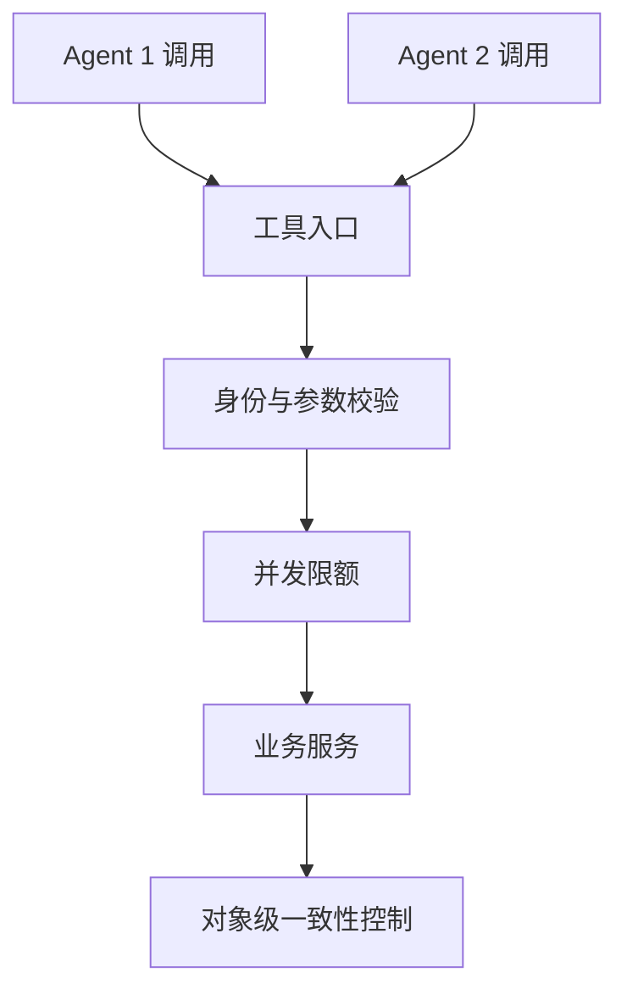

# 97. 多 Agent 能同时调用同一个工具吗？

> **场景引入**：两个 Agent 同时查天气通常容易并行；同时扣同一个账户余额则要考虑事务与重复执行。工具同名，业务并发策略却不同。

> 对应[原始材料](../origanl/97-多智能体能同时调用一个工具吗.md)。原稿称“默认单实例工具不能并发”，并非通用事实；一个 HTTP 工具服务可天然处理多个请求，具体取决于实现。

---

## 🎯 一句话定位

多个 Agent 可以同时请求名为 `get_order` 的工具；能否安全并行，取决于处理器是否线程安全、数据库连接数、外部 API 配额和业务对象是否冲突。工具“只有一个名称”不等于后台只能有一个实例；有连接池也不等于写操作就没有数据竞争。

---

## 💎 核心要点概览

| 工具类型 | 并发重点 |
| --- | --- |
| 只读查询 | 连接池、限流与权限 |
| 独立对象写入 | 幂等、事务和异常处理 |
| 同一对象写入 | 版本、锁或串行化策略 |
| 外部服务 | API 配额和过载保护 |

---

## 🚀 核心总结

> **能同时发请求不等于能安全同时改同一份业务状态。**

---

## 一、按工具类型处理

**无状态只读**查询可在限额内并发，注意下游容量和用户权限。**共享可变状态**工具要用锁、版本控制或事务；例如同时改同一库存。**外部副作用**工具如付款、发邮件要有业务幂等键，超时先查实际结果。**本地进程型**工具可能确实一次只处理一项，需依据其实现加队列或实例池。

容量规划看实际 QPS、P95/P99 延迟、连接池等待与错误率，而不是笼统开“工具池”。在多租户场景，每次调用独立传递用户身份，不能让 Agent 共享全局认证状态。

**面试口述：**“可以并发调用同一工具定义，但安全性由工具实现和下游资源决定。只读查询按配额并发，写操作按业务对象做事务、版本或幂等，必要时限流和排队。”

**自检：**两个 Agent 同时查天气与同时扣同一账户余额，为什么并发策略不同？

---

## 二、并发 Checklist

- [ ] 工具处理器和下游服务支持目标并发量。
- [ ] 每个请求身份与租户隔离。
- [ ] 同一对象写入有一致性控制。
- [ ] 写操作超时和重试有幂等保障。

## 三、总结（一句话带走）

> **工具是否安全并发，取决于共享资源和业务后果。**
