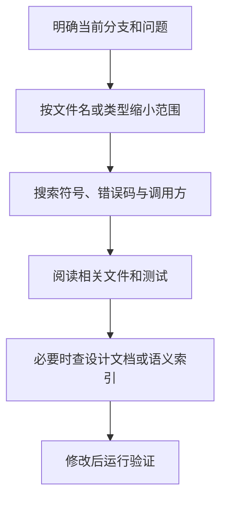

# 98. AI 写代码为什么常先用文件搜索

> **场景引入**：本地刚改了函数签名，向量索引仍返回上周代码。若据此修改调用方，很可能引入新错误。

> 对应[原始材料](../origanl/98-为什么AI写代码不用RAG？.md)。原稿关于 Codex 历史产品方案及“关键词搜索达到 RAG 90% 效果”的说法未给可靠出处，不作为事实。

---

## 🎯 一句话定位

在当前工作区修改代码，准确的文件版本、符号定义和调用位置往往比“语义相似的旧片段”更重要。文件名筛选、文本搜索与按需阅读可直接观察当前代码；RAG 对自然语言查找、架构说明和跨仓库资料仍可能有帮助。实际是检索策略组合问题，不是“AI 写代码一律不用 RAG”。

---

## 💎 核心要点概览

| 问题 | 适合的检索 |
| --- | --- |
| 当前函数与错误码 | 文件名、符号和文本搜索 |
| 调用关系 | 逐层阅读当前代码和测试 |
| 历史设计理由 | 语义检索文档与提交记录 |
| 最终判断 | 回到当前文件与测试验证 |

---

## 🚀 核心总结

> **代码修改先以当前工作区为准，语义索引用来补充难以字面定位的知识。**

---

## 一、为什么逐层搜索

假设修复 `CreateOrder` 的库存错误。先搜函数名定位实现，再搜调用方与错误码，最后读相关上下文。这样不会把整个仓库塞进模型输入。若函数被重命名，字符串搜索可能找不到，此时可用调用关系、历史提交或语义检索补充。大仓库搜索命中太多时，按目录、语言、文件类型和测试名逐步收敛。

向量索引的主要挑战是版本、分支、切块边界和权限；实时文件搜索也有局限，例如跨仓库知识和自然语言概念检索。是否引入索引用任务集评估：找到正确文件的比例、引用版本、延迟、成本和维护工作。

**面试口述：**“代码修改先确认分支与当前文件，按文件名、符号和调用链渐进检索，必要时用语义索引补足自然语言查找。结论回到代码和测试验证，避免索引过期误导。”

**自检：**向量索引返回上周版本代码，而本地刚改了函数签名，应以哪个为准？

---

## 二、检索 Checklist

- [ ] 已确认当前分支与文件状态。
- [ ] 先查符号、错误码和调用方。
- [ ] 索引结果带版本，不覆盖本地新事实。
- [ ] 代码结论通过实际测试或静态检查核验。

## 三、总结（一句话带走）

> **检索手段可组合，但当前代码与可复现测试是最终依据。**
