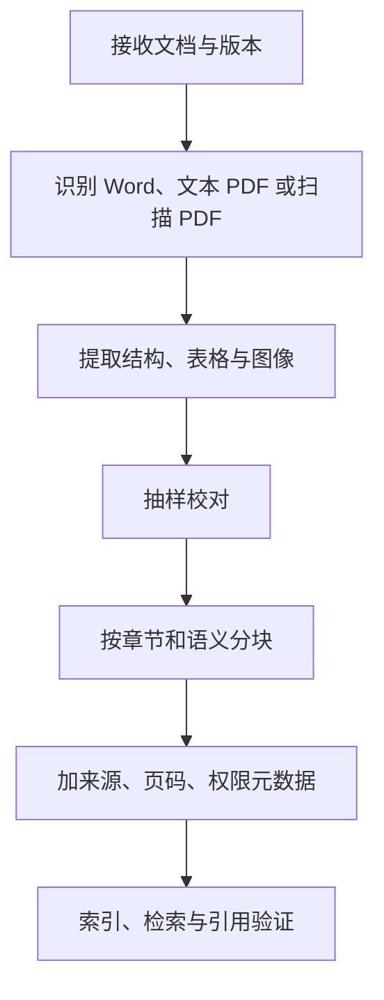

# 99. Word 与 PDF 入库：解析质量决定检索上限

> **场景引入**：表格中的“100”写在某行，单位却在上一页表头。直接把单行切片入库，模型可能把 100 元误读成 100 万元。

> 对应[原始材料](../origanl/99-RAG如何处理PDF与Word.md)。原稿给出的固定分块大小、重叠率和效果提升百分比不适用于所有资料，需要实测。

---

## 🎯 一句话定位

**Word 和 PDF 入库先保留原文结构与位置，分块大小应由证据完整性和评测决定。**

---

## 💎 核心要点概览

| 格式/内容 | 解析重点 |
| --- | --- |
| Word | 标题、段落、表格与嵌入对象 |
| 文本 PDF | 阅读顺序、双栏、页眉页脚 |
| 扫描 PDF | OCR 与关键字符核对 |
| 所有文档 | 表头、单位、条件、页码和版本 |

---

## 🚀 核心总结

> **先保证证据没有在解析和切片中失真，再优化召回。**

---

## 一、两种格式的差别

Word 通常保存标题、段落、表格等结构，但文本框、图片、公式和嵌入对象可能被解析器漏掉。PDF 首先是版面呈现，文字坐标不天然等于阅读顺序；扫描 PDF 甚至没有可选中文本，需要 OCR。无论格式，先抽取正确内容与结构，再考虑向量化。

## 二、分块时保留什么

条款的限定词、标题与正文、表格表头与单位要保持在同一可理解单元里。长表格可按行组拆，但每块都带表头和单位。每个块记录文档 ID、版本、页码或段落位置、权限标签。检索前先过滤无权访问或已过期的版本。

## 三、怎样评估解析器

从样本中挑双栏、扫描、跨页表格、公式、脚注和图片，人工核对阅读顺序和关键数字。再用问题集测“能否找到正确证据”和“答案是否忠于证据”。多模态模型可辅助理解复杂页面，但同样会误读，需要回到原页抽检。原稿说某工具或方法“效果更稳定”不能脱离具体文档类型下结论。

**面试口述：**“Word 优先利用原生结构，PDF 先判断文本还是扫描，再做版面或 OCR。结构化分块保留表头、单位与条款条件，并用原页引用和真实问题集检验。”

**自检：**文档表格里数字 100 的单位在上一页表头，直接把这一行入库会有什么风险？

---

## 四、解析 Checklist

- [ ] 逐类验证 Word、文本 PDF 与扫描 PDF。
- [ ] 表格数值与单位、表头保持关联。
- [ ] 条款条件和例外不被机械切断。
- [ ] 每段可定位到原文件版本和页码。

## 五、总结（一句话带走）

> **检索质量的上限，由可核查的文档解析结果决定。**
