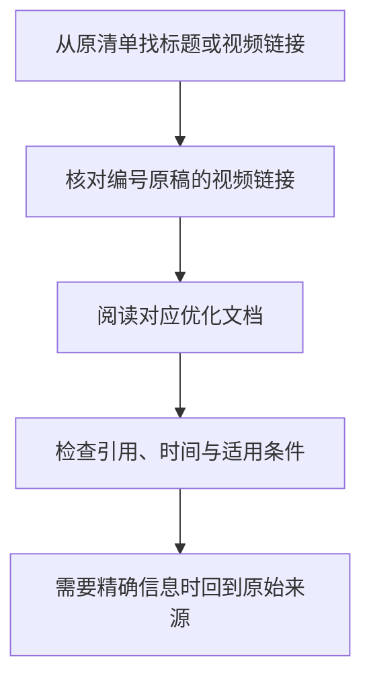

# 小哲大模型 AI 视频清单｜阅读导航与使用说明

> **场景引入**：看到视频清单第 20 条，读者想找对应的学习文档。直接按“20”匹配编号可能找错，应先核对视频链接。

> 对应[原始视频清单](../origanl/xiaozhe.md)。原清单记录 304 条作品标题和链接，采集时间为 2026-10-22；本文件是清单的阅读指南，不把标题当成经过核实的内容事实。

---

## 🎯 一句话定位

这份文档帮助读者从视频清单找到原稿与对应的优化文档，并确认来源和时效。

## 💎 核心要点概览

| 材料 | 用途 | 核对点 |
| --- | --- | --- |
| 视频清单 | 查标题和链接 | 作品 URL |
| 编号原稿 | 保存二次还原内容 | 原视频链接 |
| 优化文档 | 解释技术与适用条件 | 引用和版本 |

## 🚀 核心总结

> 三类材料通过视频链接关联，不能仅凭编号或标题认定同一作品。

---

## 一、这份资料是什么

原文件是一份视频索引，适合查找作品，不是 304 篇视频逐字稿。`02.agent/origanl` 中的编号文档多为根据视频二次还原的学习材料，其编号也不等同于原清单的作品序号。查资料时，应以每篇原稿中的视频链接核对对应作品，避免按数字直接配对。

## 二、推荐阅读路径

初学者可先看 Agent 工作闭环、工具调用、RAG 与记忆，再读执行取消、权限、幂等、评测和长任务；已有项目经验者可按故障现象查对应编号文档。课程宣传类视频适合提炼学习主题，薪资、录用率、涨价等宣传数字不应当作技术事实。

使用清单时记录视频 URL、阅读日期、对应原稿与优化文档路径。视频标题或内容可能变化，涉及时效的协议、产品特性和招聘信息，应再查官方资料与当前版本。原始 304 条链接保留在[清单原文](../origanl/xiaozhe.md)，无需在本指南复制一遍。

**一句话理解：**“清单负责找材料，编号原稿负责保存二次还原内容，优化文档负责帮助理解与核查；三者靠视频链接关联。”

---

## 三、使用 Checklist

- [ ] 从清单找到视频 URL，再核对原稿中的链接。
- [ ] 阅读对应优化文档，确认来源、日期与适用版本。
- [ ] 对时效性知识查当前官方资料，不把标题当事实。

## 四、总结（一句话带走）

> **按视频链接查材料，按来源和时间核知识。**
