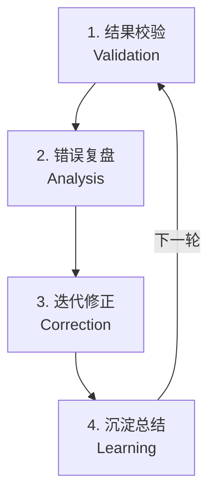

# AI Agent 的 Reflection 反思机制是什么？如何在线上场景落地？

> 面向生产环境的 AI Agent 系统设计 · 第 12 问

---

## 核心问题

1. AI Agent 的 Reflection 反思机制是什么？
2. 反思机制包含哪些执行阶段？
3. 反思机制在线上场景如何落地？有哪些避坑要点？

---

## 核心结论

**Reflection 反思机制是 Agent 独有的二次思考能力**，是模型自我检查答案、修正错误的机制。它是普通 Demo Agent 进阶成**企业级稳定智能体**的核心分水岭，也是 AI 面试的核心考点。

反思机制通过**四大阶段**（结果校验 → 错误复盘 → 迭代修正 → 沉淀总结）解决大模型的三大问题：**天生幻觉、工具调用失误、推理逻辑漏洞**。线上落地需注意：**限制最大迭代次数、区分可重试与不可重试错误、反思与业务接口独立**。

---

## 为什么需要反思机制？

### 大模型的三大固有问题

| 问题 | 描述 | 后果 |
|------|------|------|
| **天生幻觉** | 模型会生成看似合理但实际错误的内容 | 输出不可靠 |
| **工具调用失误** | 参数传错、工具选错 | 任务执行失败 |
| **推理逻辑漏洞** | 推理链条中存在逻辑错误 | 结论错误 |

### 真实线上踩坑案例

> Agent 工具参数传错，加上完整反思链路后**准确率翻倍**。

**案例说明**：
- 初始状态：Agent 调用工具时经常传错参数（如日期格式错误、ID 类型不匹配）
- 引入反思机制后：Agent 在执行前会自我检查参数格式，错误率下降 50%+

---

## 什么是 Reflection 反思机制？

### 定义

**Reflection = Agent 的二次思考能力**

类比理解：
- **普通 Agent**：像学生交卷前不检查，直接提交答案
- **带反思的 Agent**：像学霸交卷前会检查一遍，发现错误立即修改

### 核心能力

反思机制让 Agent 具备：
1. **自我评估**：判断自己的输出是否正确
2. **错误检测**：识别幻觉、工具调用错误、逻辑漏洞
3. **自我修正**：发现问题后主动修复
4. **经验沉淀**：从错误中学习，避免重复犯错

---

## 反思机制四大执行阶段



### 阶段 1：结果校验（Validation）

**目标**：判断输出是否正确

**方法**：
| 校验类型 | 方法 | 例子 |
|---------|------|------|
| **格式校验** | 检查输出是否符合 Schema | JSON 格式是否合法、必填字段是否存在 |
| **逻辑校验** | 检查推理链条是否自洽 | 因果关系是否成立、数值计算是否正确 |
| **事实校验** | 对照知识库/源文档 | 实体信息是否准确、时间线是否正确 |
| **工具调用校验** | 检查参数和返回值 | 参数类型是否正确、返回值是否为空 |

**代码示例**：
```go
// ValidationResult 校验结果
type ValidationResult struct {
    IsValid   bool
    ErrorMsg  string
}

// ValidateResult 结果校验
func ValidateResult(result map[string]interface{}, schema Schema) ValidationResult {
    // 1. 格式校验
    if !MatchesSchema(result, schema) {
        return ValidationResult{false, "格式不匹配"}
    }
    
    // 2. 逻辑校验
    if !IsLogicallyConsistent(result) {
        return ValidationResult{false, "逻辑不自洽"}
    }
    
    // 3. 事实校验
    if !MatchesKnowledgeBase(result) {
        return ValidationResult{false, "事实不准确"}
    }
    
    return ValidationResult{true, "校验通过"}
}
```

---

### 阶段 2：错误复盘（Analysis）

**目标**：定位错误的根因

**方法**：
1. **错误分类**：
   - 工具调用错误（参数错、工具选错）
   - 推理逻辑错误（因果倒置、遗漏关键步骤）
   - 事实性错误（幻觉、过时信息）

2. **根因分析**：
   - 是提示词不清晰？
   - 是工具描述不准确？
   - 是知识库缺失？

**代码示例**：
```go
// AnalyzeError 错误复盘
func AnalyzeError(errorType string, context Context) string {
    switch errorType {
    case "tool_call_error":
        // 工具调用错误
        rootCause := IdentifyWrongParameter(context)
        return fmt.Sprintf("参数错误: %s", rootCause)
    
    case "reasoning_error":
        // 推理逻辑错误
        rootCause := FindLogicGap(context)
        return fmt.Sprintf("逻辑漏洞: %s", rootCause)
    
    case "factual_error":
        // 事实性错误
        rootCause := CheckKnowledgeGap(context)
        return fmt.Sprintf("知识缺失: %s", rootCause)
    
    default:
        return "未知错误类型"
    }
}
```

---

### 阶段 3：迭代修正（Correction）

**目标**：修复错误，重新生成

**方法**：
1. **针对性修正**：
   - 参数错误 → 修正参数格式
   - 工具选错 → 重新选择工具
   - 逻辑漏洞 → 补充推理步骤
   - 事实错误 → 检索知识库

2. **循环迭代**：
   - 修正后重新执行
   - 再次校验
   - 直到通过或达到最大迭代次数

**代码示例**：
```go
// CorrectAndRetry 迭代修正
func CorrectAndRetry(task Task, maxRetries int) (Result, error) {
    for attempt := 0; attempt < maxRetries; attempt++ {
        // 执行任务
        result := ExecuteTask(task)
        
        // 结果校验
        validation := ValidateResult(result.Data, result.Schema)
        
        if validation.IsValid {
            return result, nil // 校验通过，返回结果
        }
        
        // 错误复盘
        errorAnalysis := AnalyzeError(validation.ErrorMsg, task.Context)
        
        // 修正任务
        task = ApplyCorrection(task, errorAnalysis)
        
        fmt.Printf("第 %d 次修正: %s\n", attempt+1, errorAnalysis)
    }
    
    return Result{}, fmt.Errorf("达到最大重试次数 %d", maxRetries)
}
```

---

### 阶段 4：沉淀总结（Learning）

**目标**：从错误中学习，避免重复犯错

**方法**：
1. **错误模式提取**：
   - 记录常见错误类型
   - 提取错误模式（如"日期格式经常传错"）

2. **经验沉淀**：
   - 更新提示词（加入注意事项）
   - 更新工具描述（明确参数要求）
   - 更新知识库（补充缺失信息）

3. **长期优化**：
   - 微调模型（针对高频错误）
   - 优化提示词模板
   - 完善工具 Schema

**代码示例**：
```go
// LearnFromError 沉淀总结
func LearnFromError(errorPattern string, taskHistory []Task) {
    // 1. 提取错误模式
    patterns := ExtractPatterns(taskHistory)
    
    // 2. 更新提示词
    if patterns["date_format_error"] {
        UpdatePrompt("日期格式必须使用 YYYY-MM-DD")
    }
    
    // 3. 更新工具描述
    if patterns["user_id_type_error"] {
        UpdateToolSchema("user_id", "必须是字符串类型")
    }
    
    // 4. 记录经验
    SaveExperience(errorPattern, solution)
}
```

---

## 反思机制三大核心落地场景

### 场景 1：工具调用纠错

**问题**：Agent 经常传错工具参数

**反思流程**：
```
1. 执行工具调用
2. 校验参数格式（类型、必填、范围）
3. 如果错误 → 复盘根因 → 修正参数 → 重试
4. 记录错误模式，更新工具 Schema
```

**例子**：
```go
// 初始调用（错误）
CallTool("get_weather", map[string]string{"date": "2024/10/07"})  // ❌ 格式错误

// 反思后修正
CallTool("get_weather", map[string]string{"date": "2024-10-07"})  // ✅ 格式正确
```

---

### 场景 2：推理逻辑纠错

**问题**：Agent 推理链条存在逻辑漏洞

**反思流程**：
```
1. 生成推理链条
2. 检查逻辑一致性（因果关系、数值计算）
3. 如果发现漏洞 → 补充推理步骤 → 重新生成
4. 记录逻辑模式，优化提示词
```

**例子**：
```
初始推理：
"A 公司利润增长 20%，所以股价一定上涨" 
❌ 忽略了市场情绪、行业趋势等因素

反思后修正：
"A 公司利润增长 20%，在行业整体向好的背景下，股价可能上涨，
但需考虑市场情绪、政策变化等因素" 
✅ 更全面
```

---

### 场景 3：回答内容纠错

**问题**：Agent 生成的内容存在幻觉或事实错误

**反思流程**：
```
1. 生成回答
2. 对照知识库/源文档验证事实
3. 如果发现错误 → 检索正确信息 → 重新生成
4. 更新知识库，补充缺失信息
```

**例子**：
```
初始回答：
"Python 是 1995 年由 Guido van Rossum 创造的" 
❌ 实际是 1991 年

反思后修正：
"Python 是 1991 年由 Guido van Rossum 创造的" 
✅ 事实准确
```

---

## 线上反思机制避坑重点

### 避坑 1：限制最大迭代次数

**问题**：反思循环可能无限执行，导致资源耗尽

**解决方案**：
```go
const MAX_REFLECTION_ROUNDS = 3 // 硬性上限

// ReflectWithLimit 带限制的反思
func ReflectWithLimit(task Task) (Result, error) {
    var lastResult Result
    
    for round := 0; round < MAX_REFLECTION_ROUNDS; round++ {
        // 执行并校验
        result, err := ExecuteAndValidate(task)
        if err != nil {
            return Result{}, err
        }
        
        if result.IsValid {
            return result, nil // 校验通过
        }
        
        lastResult = result
    }
    
    // 达到上限，返回最佳结果或降级处理
    return FallbackResult(lastResult), nil
}
```

**为什么重要**：
- 防止死循环
- 控制 token 消耗
- 保证响应时间

---

### 避坑 2：区分可重试错误和不可重试错误

**问题**：不是所有错误都值得重试

**分类处理**：
| 错误类型 | 是否可重试 | 处理方式 |
|---------|-----------|---------|
| **参数格式错误** | ✅ 可重试 | 修正参数，重试 |
| **工具暂时不可用** | ✅ 可重试 | 等待后重试 |
| **逻辑推理错误** | ✅ 可重试 | 补充推理，重试 |
| **权限不足** | ❌ 不可重试 | 直接报错，人工介入 |
| **资源不存在** | ❌ 不可重试 | 直接报错，不浪费资源 |
| **模型能力上限** | ❌ 不可重试 | 降级到人工处理 |

**代码示例**：
```go
// ShouldRetry 判断是否可重试
func ShouldRetry(err Error) bool {
    retryableErrors := map[string]bool{
        "parameter_format_error":         true,
        "tool_temporarily_unavailable":   true,
        "reasoning_logic_error":          true,
    }
    return retryableErrors[err.Type]
}

// HandleError 错误处理
func HandleError(err Error) (Result, error) {
    if ShouldRetry(err) {
        return RetryWithReflection()
    } else {
        return ReportErrorAndEscalate()
    }
}
```

---

### 避坑 3：反思和业务接口独立

**问题**：反思逻辑和业务逻辑耦合，难以维护和升级

**解决方案**：
```
┌─────────────────┐
│  业务接口层      │  ← 定义"做什么"
└────────┬────────┘
         │
┌────────▼────────┐
│  反思引擎层      │  ← 定义"如何检查"
└────────┬────────┘
         │
┌────────▼────────┐
│  执行引擎层      │  ← 负责"怎么做"
└─────────────────┘
```

**好处**：
- **解耦**：业务逻辑变更不影响反思逻辑
- **复用**：反思引擎可服务多个业务接口
- **可测试**：反思逻辑可独立测试

**代码示例**：
```go
// ReflectionEngine 反思引擎（独立层）
type ReflectionEngine struct {
    // 反思相关依赖
}

func (r *ReflectionEngine) Validate(result Result) bool {
    // 通用的校验逻辑
    return result.IsValid
}

func (r *ReflectionEngine) CorrectAndRetry(task Task) (Result, error) {
    // 通用的修正逻辑
    return CorrectAndRetry(task, 3)
}

// BusinessAgent 业务接口层
type BusinessAgent struct {
    reflection *ReflectionEngine
    execution  *ExecutionEngine
}

func (b *BusinessAgent) ProcessTask(task Task) (Result, error) {
    // 业务逻辑：定义做什么
    result, err := b.execution.Execute(task)
    if err != nil {
        return Result{}, err
    }
    
    // 反思逻辑：检查是否正确（独立）
    if !b.reflection.Validate(result) {
        result, err = b.reflection.CorrectAndRetry(task)
        if err != nil {
            return Result{}, err
        }
    }
    
    return result, nil
}
```

---

## 面试表述建议

> "Reflection 反思机制是 Agent 的**二次思考能力**，通过**四大阶段**（结果校验 → 错误复盘 → 迭代修正 → 沉淀总结）解决大模型的幻觉、工具调用失误和推理逻辑漏洞。
> 
> 线上落地有三个避坑要点：
> 1. **限制最大迭代次数**，防止死循环和资源耗尽
> 2. **区分可重试和不可重试错误**，避免无效重试
> 3. **反思和业务接口独立**，保证可维护性和复用性
> 
> 反思机制是区分 **Demo 玩具项目**和**企业级生产项目**的核心分水岭。"

---

## 生活化比喻

把 AI Agent 反思机制想象成**学霸考试**：

| 反思阶段 | 学霸做法 | 普通学生做法 |
|---------|---------|-------------|
| **结果校验** | 做完检查一遍 | 做完直接交卷 |
| **错误复盘** | 发现错误，分析原因 | 不检查，不知道错 |
| **迭代修正** | 修正错误，重新计算 | 错了就错了 |
| **沉淀总结** | 记录错题，下次避免 | 下次还犯同样的错 |

**结果**：学霸成绩稳定，普通学生时好时坏

---

## 一句话总结

> **Reflection 反思机制是 Agent 的二次思考能力**，通过四大阶段（结果校验 → 错误复盘 → 迭代修正 → 沉淀总结）解决大模型的幻觉、工具调用失误和推理逻辑漏洞。线上落地需记住三点：**限制迭代次数、区分错误类型、反思与业务独立**。反思机制是区分 Demo 和企业级项目的核心分水岭。

---

## 参考资料

- 视频来源：[码渡星河 - 面试官：AI Agent的Reflection反思机制是什么？](https://www.douyin.com/video/7686813617227828480)
- 相关话题：#程序员 #AI #Agent #大模型 #计算机
